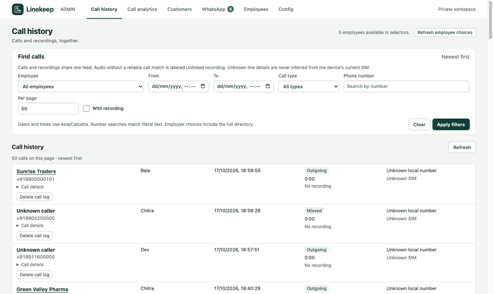
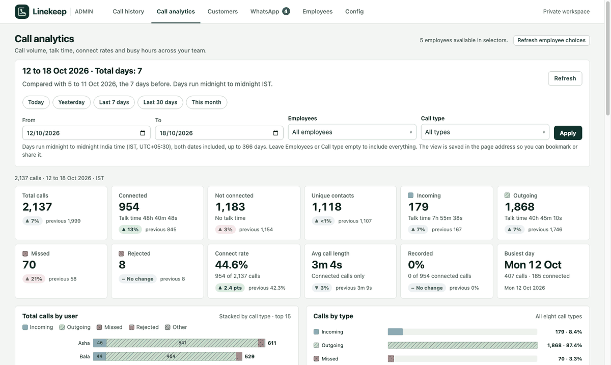
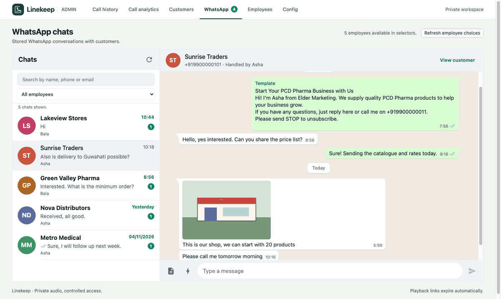
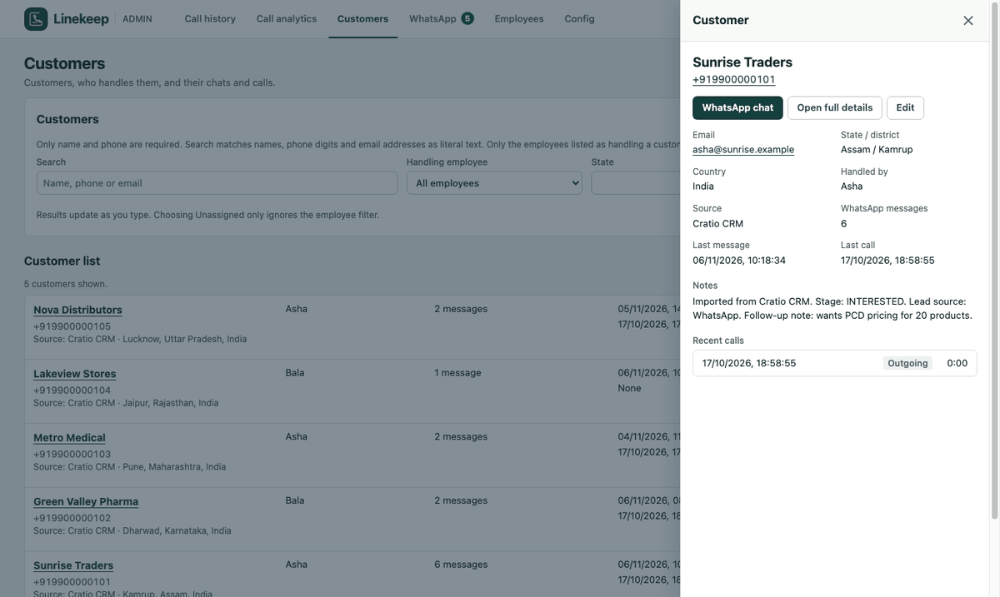
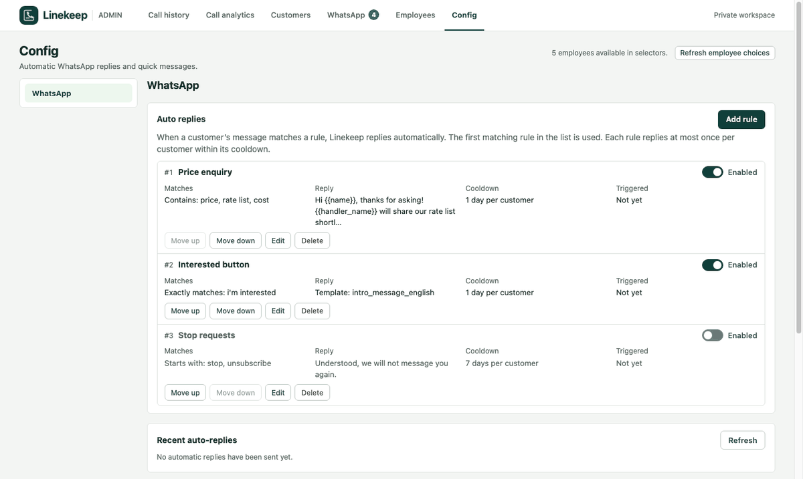
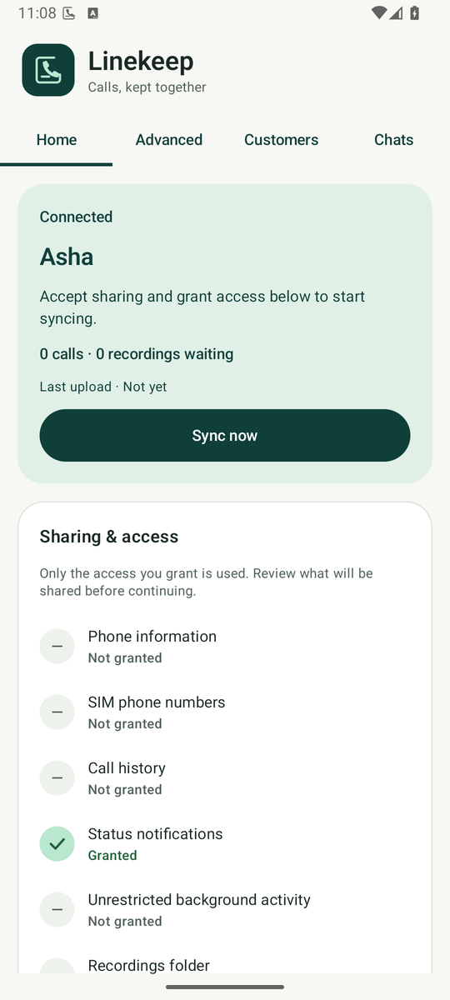
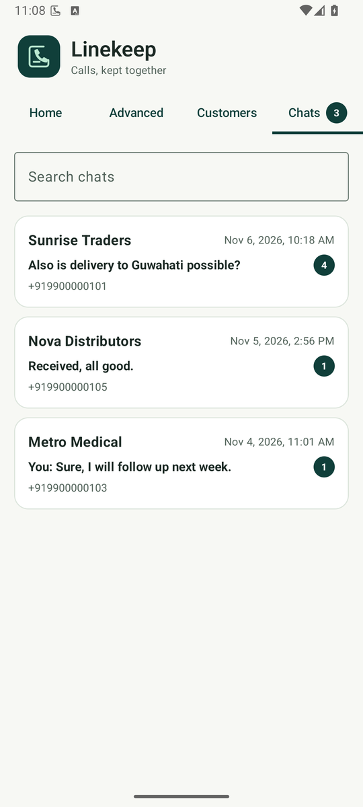
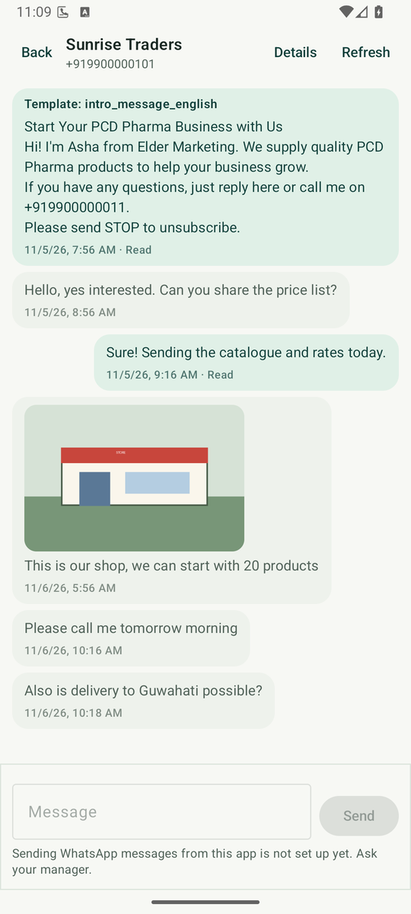
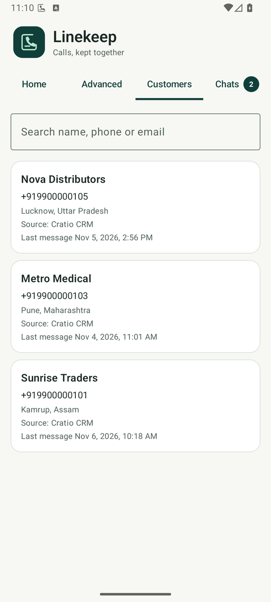

<p align="center">
  
</p>

# Linekeep

**Calls, kept together.**

Linekeep is a self-hosted Android call-history and recording workspace. The Android app shares permitted call history and existing recordings from a user-selected folder. A private web administrator panel brings them together for search, playback, download, and deletion.

**Linekeep does not record calls.** Samsung Phone creates the recordings. People using the app control installation, Android permissions, folder access, force-stop, and uninstall. Use it only with appropriate employee and caller notice, consent, and a lawful purpose.

## What it does

**Calls**

- Synchronizes available call history and readable recordings after explicit sharing consent, with durable local state and recovery after offline periods.
- Combines call logs and recordings in an administrator feed, including cached caller names and call-specific line information when available.
- Associates recordings conservatively: ambiguous audio stays visibly unlinked rather than being attached to the wrong call.
- Provides separate **Delete call log** and **Delete recording** actions, an optional retention job for old recordings, and call analytics (volume, talk time, connect rate, busy hours) with an IST day boundary.

**Customers and WhatsApp (optional)**

- Keeps customers (name, phone, location, notes, who handles them) and links their calls to them. Employees see only the customers assigned to them.
- Connects your own WhatsApp Business number through Meta's Cloud API: a WhatsApp-style inbox with live updates, per-person unread counts, pictures, voice notes and documents stored privately, and sending of text and approved templates with variable pickers and a live preview.
- A **Config** tab where admins turn features on, enter the WhatsApp, Mailgun and Firebase credentials (stored encrypted in the database, write-only in the UI) with step-by-step instructions on each page, set the daily email time, and manage automatic replies to matching messages and shared quick messages, and a customer sidebar you can open from the call log, the chat list or the customer list.
- **Bulk add** on the Customers tab: paste or choose a CSV of up to 2000 customers, assign them to one employee or split them evenly, and optionally send each newly added customer an intro WhatsApp template using its default header file and remembered variable mapping.
- Push notifications (Firebase Cloud Messaging) tell an employee when a customer assigned to them writes, or when a customer is newly assigned to them.
- Gives employees a download page and QR code (**Config → Android app**) that sends them to the community Android build in the open-source GitHub releases, so they can install the app without a file transfer.

**Access and transparency**

- Uses one-use enrollment and recovery codes, individually revocable device credentials, and Cloudflare Access for administrators.
- Keeps a visible launcher, a named status notification, and a Quick Settings entry. There is no covert activation or permission evasion.

## Screenshots

Synthetic data only. Dashboard:

| Call history | Call analytics |
| --- | --- |
|  |  |
| **WhatsApp inbox** | **Customer sidebar** |
|  |  |
| **Config: auto replies and quick messages** | |
|  | |

Employee app:

<p>
  
  
  
  
</p>

Android can defer background work; immediate delivery is not guaranteed. Linekeep does not capture VoIP calls, transcribe audio, read contacts, enforce installation, or prevent permission removal. It is not currently distributed through Google Play.

Physical Samsung folder access and manual-installer support for `READ_CALL_LOG` need verification on representative devices, Android/One UI versions, and regions before rollout. An emulator or successful build does not prove those capabilities.

## Architecture

```text
Android app                          Administrator browser
Kotlin · Compose                     Cloudflare Access
Room · WorkManager                           |
       |                                     |
       +------------ Cloudflare Worker ------+
                     TypeScript · Hono
                          /       \
                 D1 metadata     Private R2 audio
```

The app uses a device-specific bearer token. The Worker stores metadata in D1 and audio in private R2, with short-lived upload and playback capabilities. The app never receives account-level storage credentials. The backend and administrator UI deploy as one Worker.

## Quickstart

### 1. Run the backend locally

Prerequisites: Git, Node.js **22 or newer**, npm, and OpenSSL for the example secret-generation commands. Local development uses Wrangler's local D1/R2 emulation; no Cloudflare deployment is needed to use the browser and server locally.

```sh
git clone https://github.com/shubhsherl/linekeep.git
cd linekeep/server
npm ci
cp wrangler.example.jsonc wrangler.jsonc
cp .dev.vars.example .dev.vars
openssl rand -hex 32
openssl rand -hex 32
```

Put the **first** generated value in `TOKEN_HASH_SECRET` and the **second**, independent value in `LOCAL_ADMIN_SECRET` in `.dev.vars`. Do not reuse them or commit them. Keep `TOKEN_HASH_SECRET` stable once devices are enrolled: changing it invalidates existing hashed credentials and signed capabilities.

`server/wrangler.jsonc` and `server/.dev.vars` are private, ignored configuration. The example configuration is the public template; local npm scripts use your private copy.

```sh
npm run db:migrate:local
npm run dev
```

Open `http://localhost:8787/admin` and sign in with your `LOCAL_ADMIN_SECRET`. This bypass is restricted to local development and **never works on a remote deployment**.

### 2. Deploy your own backend (guided)

Device integration needs a hosted **HTTPS** backend. An interactive script provisions everything in your Cloudflare account (Worker, D1 database, private R2 bucket, Cloudflare Access protection, optional daily email and recording retention) from an API token:

```sh
cd server
npm ci
npm run setup
```

The script also asks whether to set up **WhatsApp** and **push notifications**; see [WhatsApp setup](#whatsapp-business-optional) for what to prepare first. Follow the **[step-by-step setup guide](docs/SETUP.md)** for prerequisites, the exact API-token permissions, what the script asks, and how to enroll your first phone. Prefer to do it by hand? The guide links the [manual steps](server/README.md#cloudflare-deployment). Use separate resources, Access applications and secrets for each environment; never point production at development data.

### 3. Build the Android app

Prerequisites: **JDK 17**, **Android SDK 35**, and a configured Android SDK location (`ANDROID_HOME` or private `android/local.properties`). Android 8.0/API 26 or newer is required on the device.

The app is **generic**: no server address is built in. The admin shows a QR code containing your server address and a one-time setup code, and the app scans it (or you can type both in **Advanced → Connection**). From the repository root:

```sh
cd android
./gradlew --no-daemon -Plinekeep.apiBaseUrl= :app:assembleDebug
```

The debug APK is `android/app/build/outputs/apk/debug/app-debug.apk`. With a device connected and ADB configured, install from `android/`:

```sh
adb install -r app/build/outputs/apk/debug/app-debug.apk
```

A build may optionally pre-seed a default server with `-Plinekeep.apiBaseUrl=https://...` (see the [Android guide](android/README.md)); a server saved in the app always wins. A server must be an HTTPS origin; there is no bundled shared backend. For staff devices, create a private release signing key first ([release build](android/README.md#release-build)). The application ID remains `com.microorganics.calltracker` for upgrade compatibility; it is not a credential.

### 4. Enroll and sync

1. In the administrator UI, create an employee and generate an invitation. It shows a QR code and a single-use code; share them privately with the intended user.
2. Open Linekeep on the phone, tap **Scan QR code** and scan it (or enter the server and code in **Advanced → Connection**). Read the sharing disclosure and confirm the applicable consent and retention requirements.
3. Tap **Grant permissions**: phone and call-log access, notifications, the recordings folder through Android's picker, and unrestricted background activity. Check the granted-access indicators on Home.
4. Use **Sync now**, then find the available call history and recordings in the administrator UI. Android scheduling and stable-file checks may delay uploads.

`READ_CALL_LOG` is a [hard-restricted Android permission](https://developer.android.com/reference/android/Manifest.permission#READ_CALL_LOG). The installer must allowlist it before the user can grant it; manually opening an APK does not guarantee this support. Linekeep does not replace the dialer or bypass the restriction. Denied call-log access blocks history collection, not otherwise accessible recording uploads.

For a reinstall or cleared app data, use **Recover enrollment** on the existing device in the administrator UI. A recovery code retains the enrollment and history; redemption rotates the device credential and invalidates the previous installation. Permissions and folder access must be granted again.

## WhatsApp Business (optional)

WhatsApp is off until you configure it; call history works without it. `npm run setup` asks "Set up WhatsApp now?" and, before asking for anything, prints this checklist.

**You need**

1. A Meta developer account and a **Business app** with the WhatsApp product, connected to your Meta Business (developers.facebook.com).
2. A **WhatsApp Business Account** with a registered phone number. A number cannot be active in the consumer WhatsApp app and the Cloud API at once; the app's free test number is fine for trying it. A number already managed by another provider can be moved if the WhatsApp account is owned by your business.
3. A **system user token that never expires** (Business Settings → System users, assign the app and the WhatsApp account with full control, permissions `whatsapp_business_management` and `whatsapp_business_messaging`), plus the **App ID** and **App secret** (App settings → Basic) and the **WABA ID** and **Phone number ID** (WhatsApp → API Setup).
4. For real customers: a **privacy policy URL** (you can host `docs/PRIVACY.md`), an app icon and category, then switch the app to **Live**. Until it is Live, Meta only delivers webhooks for people with a role on the app.
5. **Message templates** approved in WhatsApp Manager to start conversations, and a payment method on the WhatsApp account for paid template messages.

You can also skip this at setup time and enter everything later under **Config** in the dashboard. The script stores the tokens as Worker secrets (never in the repository), generates the webhook verify token, and can register the webhook with Meta for you. See [WhatsApp and push notifications](docs/SETUP.md) for the details and [server/README.md](server/README.md) for the manual steps. Push notifications additionally need a Firebase project (free), a service-account key, and your Firebase app identifiers; the app fetches those from your server, so the same APK works for every deployment.

Linekeep sends only messages you or your rules trigger, from your own number, and WhatsApp's business policies and opt-out rules apply. Customers' messages and files are stored in your private bucket.

## Retention and deletion

Choose and operate a retention policy before uploading real data. Recording audio can be deleted automatically after N days by the optional [retention job](server/README.md#recording-retention) (off by default; call logs are kept and there is no automatic schedule for them). R2 lifecycle rules alone do not coordinate deletion with D1 metadata.

- **Delete call log** removes the history entry from the feed and leaves its recordings as unlinked audio.
- **Delete recording** removes the server's audio and leaves the call log. Previous playback capabilities no longer retrieve the deleted audio.
- WhatsApp messages and their pictures and files are kept until you remove them; the recording retention job does not touch them and the dashboard has no delete action for them yet, so erasure requests for chats are a manual database and bucket operation.
- Neither action deletes originals from the phone or copies someone already downloaded.
- Internal metadata/tombstones remain to prevent ordinary synchronization from restoring deleted entries and to preserve conservative matching. These actions are **not a full-data-erasure API**.

Define who may listen, how long data is kept, how backups and downloaded copies are handled, how erasure requests are fulfilled, and how access is revoked when someone leaves. Use the administrator UI/API for coordinated server deletion. See [backend retention guidance](server/README.md#retention-billing-and-rollback).

## Upgrading an existing installation

Linekeep is the new display name of Calltracker. Existing users must keep the **same backend, application ID, and signing key**. Install an update without uninstalling or clearing app data to preserve enrollment and queued uploads. A newly generated debug signing key cannot update an installation signed with a different key. Do not replace an existing deployment's private configuration with the public template or rotate its hashing secret as part of this rename.

## Documentation and contributing

- [Privacy policy](docs/PRIVACY.md), [data deletion instructions](docs/DATA_DELETION.md) and [terms](docs/TERMS.md): a draft you can adapt for your own deployment and Meta's app review.
- **[Step-by-step setup guide](docs/SETUP.md)** (prerequisites, API token, guided script)
- [Backend setup and administration](server/README.md)
- [Android build and device behavior](android/README.md)
- [Frozen v1 API contract](docs/API_CONTRACT.md) and [approved additive contracts](handoffs/SERVER_AGENT.md#approved-employee-and-enrollment-extension)
- [Implementation handoff and ownership](docs/HANDOFF.md)
- [Contributing](CONTRIBUTING.md)
- [Private security reporting](SECURITY.md)

Linekeep is available under the [MIT License](LICENSE).
